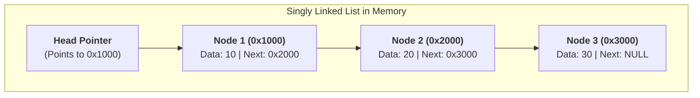
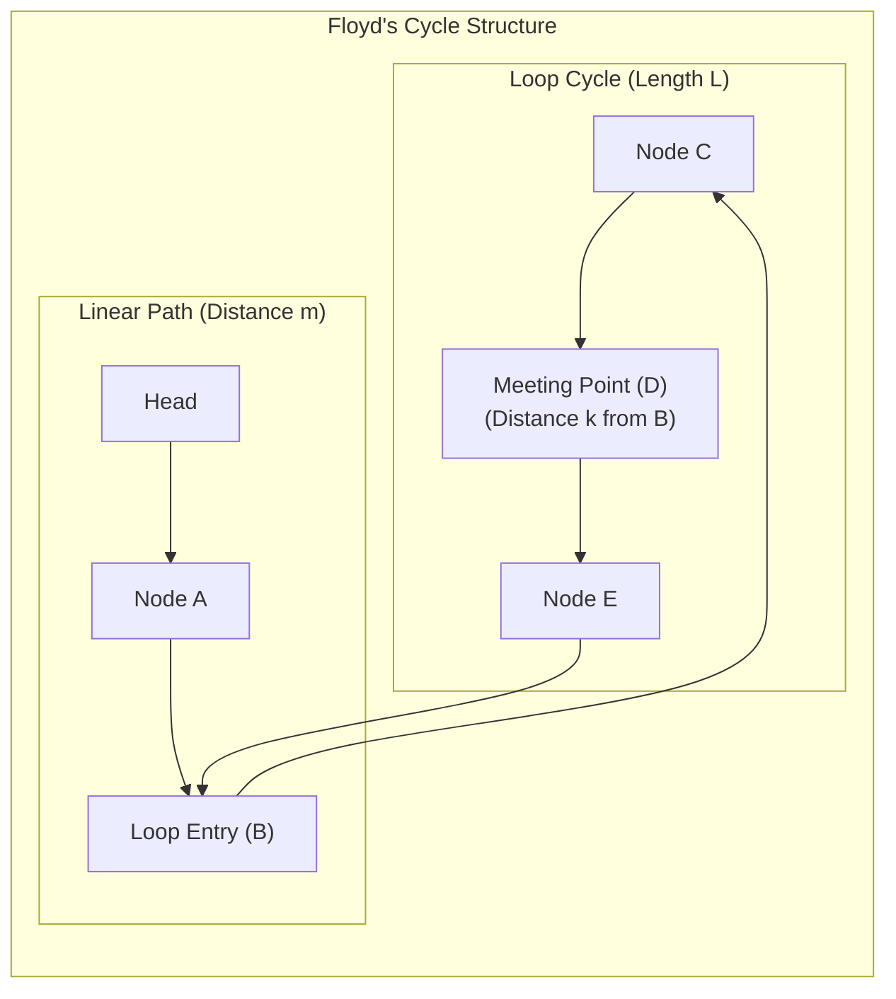

# 01. Special Matrices & Linked Lists

Linear data structures organize data elements sequentially. In the GATE examination, this subject is heavily tested through **special matrix address mapping formulas** and **linked list pointer manipulations** (reversals, cycle detection, and traversals).

---

## 1. Special Matrices & 1D Array Mapping

Sparse and structured matrices occur extensively in engineering. Storing full $n \times n$ matrices wastes memory on zeroes; mapping them into compacted 1D arrays saves space while preserving $\mathcal{O}(1)$ element access.

### 1.1 Special Matrix Summary Table

| Matrix Type | Defining Condition ($A[i][j] \neq 0$) | Total Non-Zero Elements | Space Saved vs. Full $n^2$ |
| :--- | :---: | :---: | :---: |
| **Diagonal** | $i = j$ | $n$ | $\approx 100\%$ |
| **Tridiagonal** | $\lvert i - j \rvert \le 1$ | $3n - 2$ | $\approx 100\%$ |
| **Lower Triangular** | $i \ge j$ | $\frac{n(n + 1)}{2}$ | $\approx 50\%$ |
| **Upper Triangular** | $i \le j$ | $\frac{n(n + 1)}{2}$ | $\approx 50\%$ |
| **Symmetric** | $A[i][j] = A[j][i]$ | $\frac{n(n + 1)}{2}$ | $\approx 50\%$ |

---

### 1.2 Lower Triangular Matrix (LTM) Address Formulas

An $n \times n$ matrix is Lower Triangular if all entries above the main diagonal are zero ($A[i][j] = 0$ for $i < j$).

$$
\begin{bmatrix}
a_{00} & 0 & 0 & \dots & 0 \\
a_{10} & a_{11} & 0 & \dots & 0 \\
a_{20} & a_{21} & a_{22} & \dots & 0 \\
\vdots & \vdots & \vdots & \ddots & \vdots \\
a_{n-1,0} & a_{n-1,1} & a_{n-1,2} & \dots & a_{n-1,n-1}
\end{bmatrix}
$$

#### 1. Row-Major Order (RMO) Mapping (0-indexed):
Row $0$ stores $1$ element; Row $1$ stores $2$ elements; $\dots$; Row $i-1$ stores $i$ elements.
To reach row $i$, we skip:

$$ \sum_{k=0}^{i-1} (k + 1) = \frac{i(i + 1)}{2} \quad \text{elements} $$

Inside row $i$, we take $j$ steps. Hence:

$$ \boxed{\text{Index}_{\text{RMO}}(i, j) = \frac{i(i + 1)}{2} + j} $$

*(For 1-based indexing: $\text{Index}_{\text{RMO}}(i, j) = \frac{i(i - 1)}{2} + (j - 1)$)*

#### 2. Column-Major Order (CMO) Mapping (0-indexed):
Column $0$ stores $n$ elements, Column $1$ stores $n - 1$ elements, etc.

$$ \boxed{\text{Index}_{\text{CMO}}(i, j) = \Big[n \cdot j - \frac{j(j - 1)}{2} + (i - j)\Big]} $$

---

### 1.3 Upper Triangular Matrix (UTM) Address Formulas

An $n \times n$ matrix is Upper Triangular if all entries below the main diagonal are zero ($A[i][j] = 0$ for $i > j$).

#### 1. Row-Major Order (RMO) Mapping (0-indexed):
Row $0$ contains $n$ elements, row $1$ contains $n-1$, etc.

$$ \boxed{\text{Index}_{\text{RMO}}(i, j) = \Big[n \cdot i - \frac{i(i - 1)}{2} + (j - i)\Big]} $$

#### 2. Column-Major Order (CMO) Mapping (0-indexed):
Column $j$ has $(j + 1)$ elements above and including the diagonal:

$$ \boxed{\text{Index}_{\text{CMO}}(i, j) = \frac{j(j + 1)}{2} + i} $$

---

## 2. Linked Lists

A linked list is a linear collection of data nodes whose order is not given by their physical placement in memory, but by pointers embedded within each node.



### 2.1 Time Complexity Comparison of Linked List Operations

| Operation | Singly Linked List (SLL) | SLL with Tail Pointer | Doubly Linked List (DLL) | Array (Contiguous) |
| :--- | :---: | :---: | :---: | :---: |
| **Insert at Head** | $\mathcal{O}(1)$ | $\mathcal{O}(1)$ | $\mathcal{O}(1)$ | $\mathcal{O}(n)$ |
| **Insert at Tail** | $\mathcal{O}(n)$ | $\mathcal{O}(1)$ | $\mathcal{O}(1)$ | $\mathcal{O}(1)$ amortized |
| **Delete at Head** | $\mathcal{O}(1)$ | $\mathcal{O}(1)$ | $\mathcal{O}(1)$ | $\mathcal{O}(n)$ |
| **Delete at Tail** | $\mathcal{O}(n)$ | $\mathcal{O}(n)$ *(must find prev)* | $\mathcal{O}(1)$ | $\mathcal{O}(1)$ |
| **Delete given node pointer $P$** | $\mathcal{O}(n)$ *(must find prev)* | $\mathcal{O}(n)$ | **$\mathcal{O}(1)$** | $\mathcal{O}(n)$ |
| **Search (Unsorted)** | $\mathcal{O}(n)$ | $\mathcal{O}(n)$ | $\mathcal{O}(n)$ | $\mathcal{O}(n)$ |
| **Random Access ($i$-th element)**| $\mathcal{O}(n)$ | $\mathcal{O}(n)$ | $\mathcal{O}(n)$ | **$\mathcal{O}(1)$** |

> [!TIP]
> **GATE Insight: Why deleting tail is $\mathcal{O}(n)$ in SLL with a tail pointer!**
> Even with a tail pointer `tail`, deleting the last node requires updating `tail` to the second-to-last node. Because links are unidirectional, finding the predecessor node requires traversing from `head`, costing $\mathcal{O}(n)$ time. In a **Doubly Linked List (DLL)**, `tail->prev` directly yields the predecessor in $\mathcal{O}(1)$ time!

---

## 3. High-Yield Linked List Algorithms

### 3.1 Reversing a Singly Linked List (Iterative 3-Pointer Method)

```c title="reverse_list.c" linenums="1"
struct Node* reverseList(struct Node *head) {
    struct Node *prev = NULL;
    struct Node *curr = head;
    struct Node *next = NULL;
    
    while (curr != NULL) {
        next = curr->next; // 1. Save next node
        curr->next = prev; // 2. Reverse link
        prev = curr;       // 3. Advance prev
        curr = next;       // 4. Advance curr
    }
    return prev; // New head of reversed list
}
```
- **Time Complexity**: $\mathcal{O}(n)$ (single pass).
- **Space Complexity**: $\mathcal{O}(1)$ auxiliary space.

---

### 3.2 Floyd's Cycle Detection Algorithm (Tortoise & Hare)

Floyd's algorithm uses two pointers:
- `slow` moves **1 step** per iteration: $s \leftarrow s \to \text{next}$.
- `fast` moves **2 steps** per iteration: $f \leftarrow f \to \text{next} \to \text{next}$.



#### Mathematical Proof of Cycle Detection & Start Point:
Let:
- $m =$ distance from Head to the start of the loop.
- $L =$ total length of the loop.
- $k =$ distance from start of loop to the meeting point $D$.

When `slow` and `fast` meet:
- Distance traveled by `slow`: $d_{\text{slow}} = m + k$
- Distance traveled by `fast`: $d_{\text{fast}} = m + k + q \cdot L$ (where $q$ is loop revolutions).
- Since `fast` moves twice as fast as `slow`:

$$ d_{\text{fast}} = 2 \cdot d_{\text{slow}} \implies m + k + q \cdot L = 2(m + k) $$

$$ q \cdot L = m + k \implies \boxed{m = q \cdot L - k} $$

**Conclusion**:
If we place one pointer at `head` and keep another at the meeting point $D$, and advance both **one step at a time**, after traveling distance $m$, the head pointer reaches the loop start, and the loop pointer travels $q \cdot L - k$, landing **exactly at the start of the loop**!

---

## 4. Real Recent GATE Solved Problems

???+ example "GATE 2026 CS1 Q.39: Recursive Singly Linked List Traversal"
    **Question**: Consider the following code snippet in C language that operates on a non-empty singly linked list:
    ```c
    int count(struct Node *p) {
        if (p == NULL)
            return 0;
        return 1 + count(p->next);
    }
    ```
    If a list contains $n$ nodes, what are the time and auxiliary space complexities?
    
    **Solution**:
    - Every node is visited once before the base case `p == NULL` is triggered. Total calls = $n + 1 \implies \mathcal{O}(n)$ time.
    - Each function invocation allocates a stack frame on the call stack. The recursion depth reaches $n + 1$.
    - **Time Complexity**: $\mathcal{O}(n)$
    - **Space Complexity**: $\mathcal{O}(n)$ auxiliary stack space.

---

??? example "GATE 2025 CS1 Q.62: Linked List Pointer Updates"
    **Question**: Let `LIST` be a datatype for a linked list:
    ```c
    typedef struct list {
        int data;
        struct list *next;
    } LIST;
    ```
    Given a list with head `p` pointing to nodes `[10 -> 20 -> 30 -> 40]`. What list is produced after the following operations?
    ```c
    LIST *q = p->next;
    p->next = q->next;
    q->next = p;
    p = q;
    ```
    **Solution**:
    1. Initially: `p` points to `10`, `p->next` points to `20`.
    2. `q = p->next`: `q` points to `20`.
    3. `p->next = q->next`: `10->next` now points to `30`. (List: `10 -> 30 -> 40`).
    4. `q->next = p`: `20->next` now points to `10`.
    5. `p = q`: New head is `20`.
    6. **Result**: First two nodes are swapped: `[20 -> 10 -> 30 -> 40]`.
