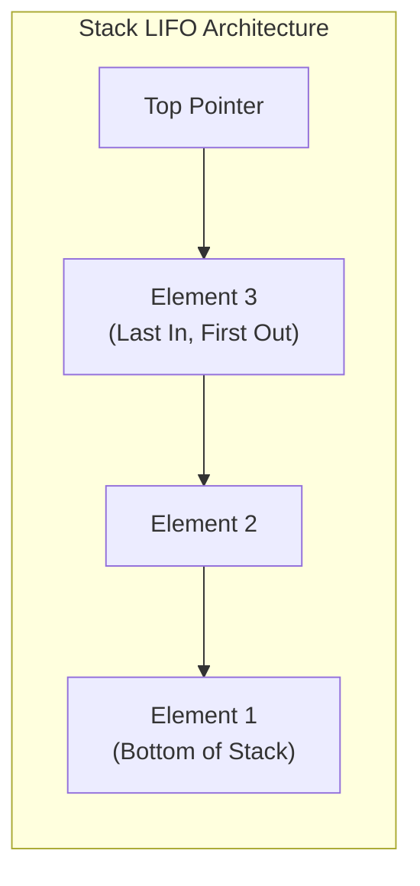
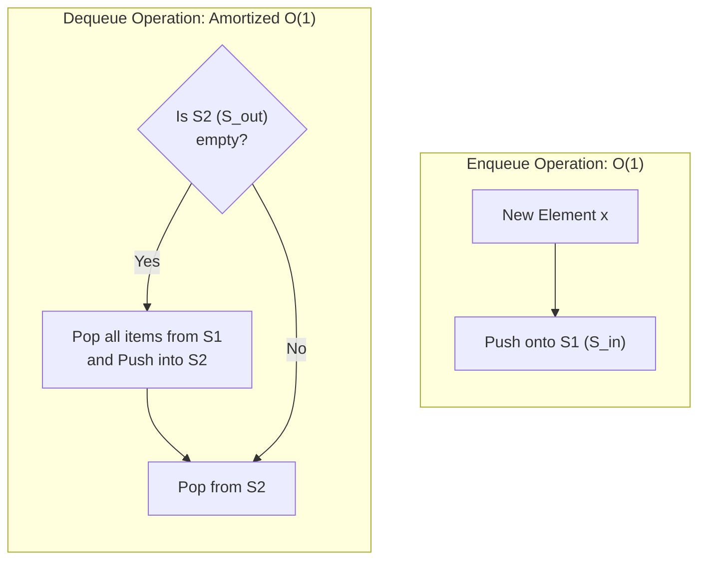

# 02. Stacks & Expression Processing

The **Stack** is a foundational linear data structure adhering strictly to the **Last-In, First-Out (LIFO)** access discipline. In the GATE examination, stacks are frequently tested via **expression conversions (Infix, Postfix, Prefix)**, **valid stack permutations (Catalan numbers)**, and **queue simulation using finite-capacity stacks**.

---

## 1. Stack Abstract Data Type (ADT)

All insertions and deletions take place at a single end, designated as the **Top of Stack**.

### 1.1 Core Operations & Complexities

| Operation | Description | Array Implementation ($\mathcal{O}$) | Linked List Implementation ($\mathcal{O}$) |
| :--- | :--- | :---: | :---: |
| `push(x)` | Inserts element $x$ onto the top of the stack | $\mathcal{O}(1)$ | $\mathcal{O}(1)$ |
| `pop()` | Removes and returns the top element | $\mathcal{O}(1)$ | $\mathcal{O}(1)$ |
| `peek()` / `top()` | Returns the top element without removing it | $\mathcal{O}(1)$ | $\mathcal{O}(1)$ |
| `isEmpty()` | Checks if stack has 0 elements | $\mathcal{O}(1)$ | $\mathcal{O}(1)$ |
| `isFull()` | Checks if static array bounds are reached | $\mathcal{O}(1)$ | N/A (Heap bound) |

- **Stack Overflow**: Attempting to `push` onto a stack when `top == capacity - 1`.
- **Stack Underflow**: Attempting to `pop` or `peek` when `top == -1` (or `head == NULL`).

---

## 2. Expression Parsing & Conversions

| Notation Format | Placement of Operator | Example Expression | Needs Parentheses? |
| :--- | :--- | :---: | :---: |
| **Infix** | Between operands: $A \star B$ | $(A + B) \times C$ | **Yes** (Ambiguous without) |
| **Prefix (Polish)** | Before operands: $\star A B$ | $\times + A B C$ | **No** (Unambiguous) |
| **Postfix (Reverse Polish / RPN)** | After operands: $A B \star$ | $A B + C \times$ | **No** (Unambiguous) |

### 2.1 Infix to Postfix Conversion (Shunting-Yard Rules)

1. Scan the infix expression from **left to right**.
2. If the scanned character is an **operand**, append it directly to the postfix output.
3. If an **opening parenthesis `'('`** is encountered, push it onto the operator stack.
4. If a **closing parenthesis `')'`** is encountered, pop and output operators from the stack until an `'('` is encountered. Pop and discard the `'('`.
5. If an **operator $\star$** is scanned:
   - While the stack is not empty, top is not `'('`, and $\text{Precedence}(\text{top}) \ge \text{Precedence}(\star)$ (or $>$ if right-associative):
     Pop `top` and append it to the postfix output.
   - Push operator $\star$ onto the stack.
6. At the end of the expression, pop and output all remaining operators on the stack.

---

### 2.2 Evaluation of Postfix Expressions (RPN)

Algorithm:
1. Scan the postfix string from **left to right**.
2. If token is an **operand**, push its numerical value onto the stack.
3. If token is an **operator $\star$**:
   - Pop operand $op_2$ (the top element).
   - Pop operand $op_1$ (the next element).
   - Compute: $\text{result} = op_1 \star op_2$.
   - Push $\text{result}$ back onto the stack.
4. When finished, the single element remaining in the stack is the final expression value.

> [!WARNING]
> **GATE Trap: Operand Order in Subtraction and Division**
> The **first popped** item is the right-hand operand ($op_2$), and the **second popped** item is the left-hand operand ($op_1$):
> 
> $$ \text{Result} = op_1 - op_2 \quad (\text{NOT } op_2 - op_1) $$

---

## 3. Stack Permutations & Catalan Numbers

Given a fixed input sequence $\langle 1, 2, 3, \dots, n \rangle$ pushed in order, how many distinct output permutations can be generated using a single stack?

The total number of valid stack permutations of length $n$ is given by the **$n$-th Catalan Number**:

$$ \boxed{C_n = \frac{1}{n + 1} \binom{2n}{n} = \frac{(2n)!}{(n + 1)! \, n!}} $$

| $n$ (Elements) | Catalan Formula | Valid Output Permutations | Total Possible Permutations ($n!$) |
| :---: | :---: | :---: | :---: |
| **1** | $C_1 = \frac{1}{2}\binom{2}{1}$ | **1** | $1! = 1$ |
| **2** | $C_2 = \frac{1}{3}\binom{4}{2}$ | **2** | $2! = 2$ |
| **3** | $C_3 = \frac{1}{4}\binom{6}{3}$ | **5** | $3! = 6$ (Impossible: `3 1 2`) |
| **4** | $C_4 = \frac{1}{5}\binom{8}{4}$ | **14** | $4! = 24$ |
| **5** | $C_5 = \frac{1}{6}\binom{10}{5}$ | **42** | $5! = 120$ |

> [!TIP]
> **Forbidden Subsequence Rule (Knuth's Criterion)**:
> A permutation is a valid stack permutation if and only if it **contains no subsequence of the pattern $3-1-2$** (a larger element followed later by a smaller element, followed later by an element in between).

---

## 4. Implementing a Queue Using Two Stacks

A Queue (FIFO) can be simulated using two LIFO Stacks: $S_{\text{in}}$ and $S_{\text{out}}$.

### Amortized Complexity Analysis:
- Each item is pushed onto $S_{\text{in}}$ once ($\mathcal{O}(1)$).
- When $S_{\text{out}}$ is empty, elements are popped from $S_{\text{in}}$ and pushed to $S_{\text{out}}$ once ($\mathcal{O}(1)$ per element).
- Each item is popped from $S_{\text{out}}$ once ($\mathcal{O}(1)$).
- **Total work per element over its entire lifetime** $= 4$ operations.
- **Amortized Time Complexity per Enqueue/Dequeue**: $\mathcal{O}(1)$.

---

## 5. Real Recent GATE Solved Problems

???+ example "GATE 2024 CS2 Q.48: Two Stacks Simulating a Queue with Finite Capacity"
    **Question**: Let $S_1$ and $S_2$ be two stacks.
    - $S_1$ has a capacity of **4 elements**.
    - $S_2$ has a capacity of **2 elements**.
    - Initially, $S_1$ already contains 4 elements: $[a, b, c, d]$ (where $d$ is at the top).
    - $S_2$ is initially empty.
    
    We wish to dequeue elements in FIFO order by transferring elements from $S_1$ to $S_2$. What is the maximum number of additional elements that can be enqueued and subsequently dequeued without causing stack overflow?

    **Step-by-step Solution**:
    
    1. Initial state:
       - $S_1$: $[a, b, c, d]$ (Full: $4/4$, $d$ at top).
       - $S_2$: $[\;]$ (Empty: $0/2$).
    2. To dequeue the oldest element $a$, we must reach the bottom of $S_1$.
       - Pop $d$ from $S_1$, push to $S_2$. ($S_2 = [d]$, $1/2$).
       - Pop $c$ from $S_1$, push to $S_2$. ($S_2 = [d, c]$, $2/2$ $\implies S_2$ is now **FULL**).
    3. Now $S_2$ has no remaining capacity ($2/2$). Element $b$ cannot be popped from $S_1$ into $S_2$!
    4. To make room in $S_2$, elements must be dequeued out of $S_2$.
       - But $S_2$ holds $c$ at top and $d$ beneath it. If we pop from $S_2$, we would dequeue $c$, which violates FIFO order because $a$ and $b$ arrived earlier and have not been dequeued yet!
    5. Therefore, without overflowing $S_2$, elements $b$ and $a$ can never be accessed.
    6. This classic question demonstrates the strict mathematical constraint: To reverse a stack of size $k$, the secondary stack must have capacity at least $k$.

---

??? example "GATE Practice: Postfix Evaluation"
    **Question**: Evaluate the postfix expression:

    $$ 6 \; 2 \; 3 \; + \; \times \; 3 \; 8 \; 4 \; / \; - \; + $$

    **Trace Table**:
    
    | Token | Action | Stack State (Bottom to Top) |
    | :---: | :--- | :--- |
    | `6` | Push 6 | `[6]` |
    | `2` | Push 2 | `[6, 2]` |
    | `3` | Push 3 | `[6, 2, 3]` |
    | `+` | Pop 3, 2 $\to$ $2 + 3 = 5$, Push 5 | `[6, 5]` |
    | `*` | Pop 5, 6 $\to$ $6 \times 5 = 30$, Push 30 | `[30]` |
    | `3` | Push 3 | `[30, 3]` |
    | `8` | Push 8 | `[30, 3, 8]` |
    | `4` | Push 4 | `[30, 3, 8, 4]` |
    | `/` | Pop 4, 8 $\to$ $8 / 4 = 2$, Push 2 | `[30, 3, 2]` |
    | `-` | Pop 2, 3 $\to$ $3 - 2 = 1$, Push 1 | `[30, 1]` |
    | `+` | Pop 1, 30 $\to$ $30 + 1 = 31$, Push 31 | `[31]` |

    **Final Result**: `31`.
