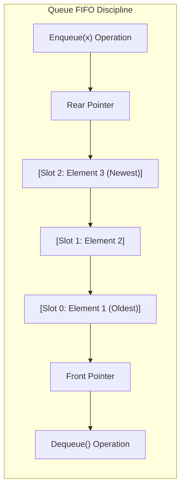
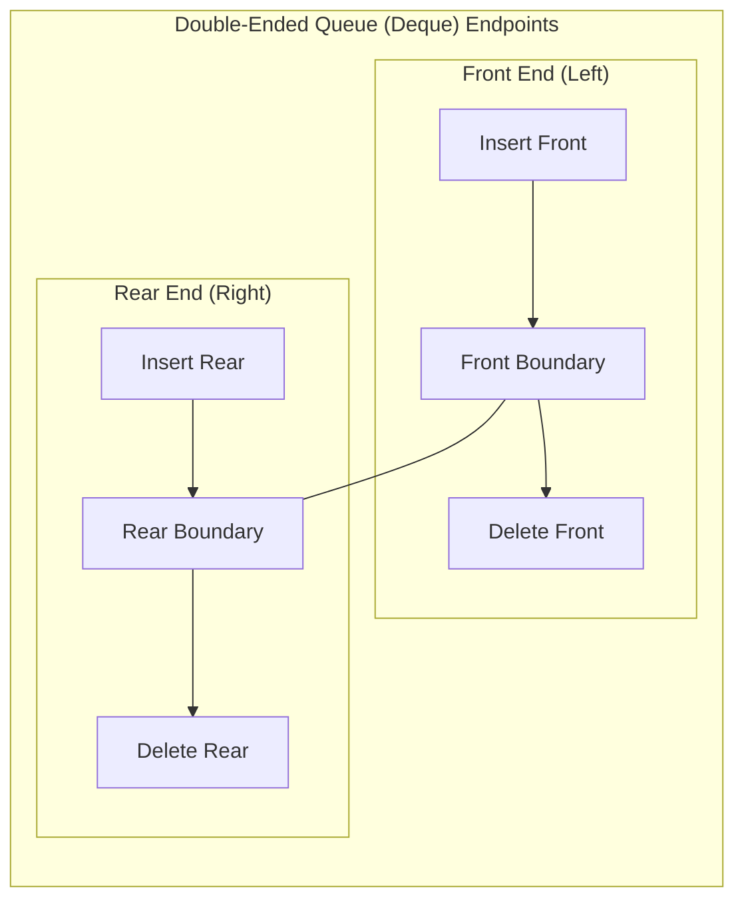

# 03. Queues & Deques

The **Queue** is an essential linear data structure governed by the **First-In, First-Out (FIFO)** operational principle. In GATE, the most frequently tested concepts include **circular queue modulo index arithmetic**, **full/empty boundary conditions**, **deque restrictions**, and **queue simulations**.

---

## 1. Queue Abstract Data Type (ADT)

In a standard Queue, elements are inserted at the **Rear** and removed from the **Front**.



### 1.1 The Linear Queue & "False Overflow"
In a simple linear array implementation with fixed capacity $N$:
- New elements are added at `rear++`.
- Elements are removed from `front++`.

> [!WARNING]
> **The False Overflow Problem**
> If multiple items are enqueued and dequeued, `rear` eventually reaches index $N - 1$. At this point, the queue signals **Overflow**, even though indices $0 \dots \text{front}-1$ are completely empty!
> Shifting all elements left on every dequeue restores space but degrades `dequeue` complexity to $\mathcal{O}(n)$.

---

## 2. Circular Queue Design & Modulo Formulas

The **Circular Queue** eliminates the false overflow problem by wrapping array indices around in a ring using modulo arithmetic.

```mermaid
flowchart TD
    subgraph RingBuffer["Circular Buffer Ring (Size = 8)"]
        direction TB
        subgraph TopRow["Top Half"]
            direction LR
            C0["Slot 0"] --> C1["Slot 1"] --> C2["Slot 2"] --> C3["Slot 3"]
        end
        subgraph BottomRow["Bottom Half"]
            direction RL
            C7["Slot 7"] <-- C6["Slot 6"] <-- C5["Slot 5"] <-- C4["Slot 4"]
        end
        C3 --> C4
        C7 --> C0
    end
```

### 2.1 The One-Slot-Empty Convention (Gateopedia Standard)
To mathematically distinguish between a **completely empty** queue and a **completely full** queue without maintaining an auxiliary counter variable, one slot is intentionally kept vacant.

Let `size` be the total array capacity:

$$ \boxed{\text{Enqueue}(\text{item}): \quad \text{rear} = (\text{rear} + 1) \pmod{\text{size}}} $$

$$ \boxed{\text{Dequeue}(): \quad \text{front} = (\text{front} + 1) \pmod{\text{size}}} $$

#### Mathematical Conditions:
- **Empty Queue Condition**:

    $$ \boxed{\text{front} == \text{rear}} $$

- **Full Queue Condition** (next step of `rear` collides with `front`):

    $$ \boxed{(\text{rear} + 1) \pmod{\text{size}} == \text{front}} $$

- **Current Number of Elements**:

    $$ \boxed{\text{Count} = (\text{rear} - \text{front} + \text{size}) \pmod{\text{size}}} $$

- **Maximum Usable Capacity**:

    $$ \text{Capacity}_{\max} = \text{size} - 1 $$

---

## 3. Double-Ended Queue (Deque)

A **Deque** (pronounced *"deck"*) is a generalized linear list where insertions and deletions can occur at **both** ends (Front and Rear).



### 3.1 Restricted Variants of Deque
1. **Input-Restricted Deque**:
   - Insertion is allowed at **only one end** (e.g., Rear only).
   - Deletion is permitted at **both ends** (Front and Rear).
2. **Output-Restricted Deque**:
   - Deletion is allowed at **only one end** (e.g., Front only).
   - Insertion is permitted at **both ends** (Front and Rear).

---

## 4. Priority Queue (PQ)

In a Priority Queue, elements are dequeued based on an associated **priority key** rather than arrival order:
- **Min-Priority Queue**: Element with minimum key value is served first.
- **Max-Priority Queue**: Element with maximum key value is served first.

### Data Structure Implementations of Priority Queue:

| Underlying Data Structure | `insert(x)` | `deleteMin()` / `deleteMax()` | `findMin()` / `findMax()` |
| :--- | :---: | :---: | :---: |
| **Unsorted Array** | $\mathcal{O}(1)$ | $\mathcal{O}(n)$ | $\mathcal{O}(n)$ |
| **Sorted Array** | $\mathcal{O}(n)$ | $\mathcal{O}(1)$ | $\mathcal{O}(1)$ |
| **Singly Linked List (Sorted)** | $\mathcal{O}(n)$ | $\mathcal{O}(1)$ | $\mathcal{O}(1)$ |
| **Binary Heap** | **$\mathcal{O}(\log n)$** | **$\mathcal{O}(\log n)$** | **$\mathcal{O}(1)$** |

---

## 5. Real Recent GATE Solved Problems

???+ example "GATE 2026 CS2 Q.50: Stack & Queue Interaction"
    **Question**: Consider a stack $S$ and a queue $Q$. Both are initially empty and each has a maximum capacity to store $10$ elements.
    We are given a sequence of integers: $\langle 1, 2, 3, 4, 5 \rangle$.
    1. First, all 5 elements are pushed onto stack $S$ in order.
    2. Then, 3 elements are popped from $S$ and enqueued into $Q$.
    3. Next, 2 elements are dequeued from $Q$ and pushed back onto $S$.
    4. Finally, 1 element is popped from $S$.
    
    What is the element popped in the final step?

    **Step-by-step Execution Trace**:
    1. **Pushing 1 to 5 to Stack $S$**:
       - Stack $S$ (bottom to top): $[1, 2, 3, 4, 5]$ ($5$ is at the top).
    2. **Pop 3 elements from $S$ and Enqueue into $Q$**:
       - First pop from $S$: $5 \implies$ Enqueue into $Q$: $Q = [5]$
       - Second pop from $S$: $4 \implies$ Enqueue into $Q$: $Q = [5, 4]$
       - Third pop from $S$: $3 \implies$ Enqueue into $Q$: $Q = [5, 4, 3]$ (Front is $5$, Rear is $3$).
       - Stack $S$ now holds: $[1, 2]$ ($2$ is at the top).
    3. **Dequeue 2 elements from $Q$ and Push to $S$**:
       - First dequeue from $Q$: $5 \implies$ Push to $S$: $S = [1, 2, 5]$
       - Second dequeue from $Q$: $4 \implies$ Push to $S$: $S = [1, 2, 5, 4]$ ($4$ is at the top).
       - Queue $Q$ now holds: $[3]$.
    4. **Pop 1 element from $S$**:
       - Top of $S$ is currently $4$.
       - Popping yields: **$4$**.

    **Final Answer**: `4`.
