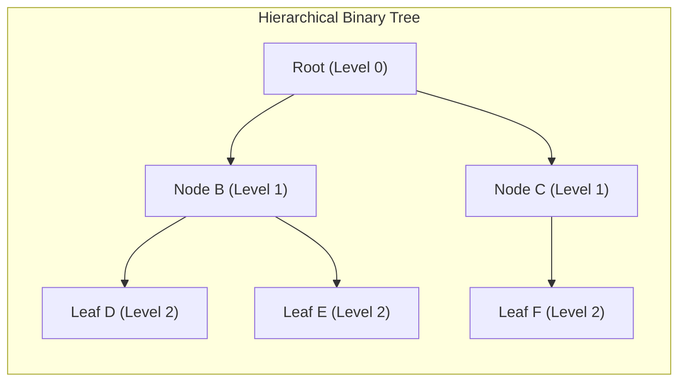

# 04. Binary Trees & Properties

The **Binary Tree** is a non-linear hierarchical data structure where each node has at most two children, referred to as the **left child** and the **right child**. In GATE, questions systematically test **combinatorial identities**, **structural node relations ($n_0 = n_2 + 1$)**, **Catalan number derivations**, and **tree traversal reconstructions**.

---

## 1. Tree Terminology & Conventions

### Height and Depth Conventions (Crucial for GATE)
> [!IMPORTANT]
> **GATE Standard Definition of Height (Edges vs. Nodes)**:
> In recent GATE papers (e.g., **GATE 2026 CS1 Q.33**), height is explicitly defined as:
> *"The height of a binary tree is the **number of edges** in the longest path from the root to a leaf."*
>
> - Single node tree: **Height = $0$ edges** (or $1$ node).
> - Empty tree: **Height = $-1$ edges** (or $0$ nodes).
> - Level of Root = $0$.

---

## 2. Binary Tree Classifications

| Tree Type | Defining Structural Property | Degree-1 Nodes ($n_1$) | Height Bounds ($h$) |
| :--- | :--- | :---: | :---: |
| **Strict / Full Binary Tree** | Every node has either $0$ or $2$ children | Strictly $n_1 = 0$ | $\log_2(n + 1) - 1 \le h \le \frac{n - 1}{2}$ |
| **Complete Binary Tree (CBT)** | All levels completely full except possibly the last; last level filled strictly left-to-right | At most $1$ ($n_1 \in \{0, 1\}$) | $h = \lfloor \log_2 n \rfloor$ |
| **Perfect Binary Tree** | All internal nodes have $2$ children; all leaf nodes are at the identical maximum level | Strictly $n_1 = 0$ | $h = \log_2(n + 1) - 1$ |
| **Degenerate / Skewed Tree** | Every internal node has exactly $1$ child (left-skewed or right-skewed) | $n_1 = n - 1$ | $h = n - 1$ (Worst-case height) |

---

## 3. Fundamental Mathematical Theorems & Proofs

### 3.1 Theorem 1: Leaf Nodes vs. Degree-2 Nodes ($n_0 = n_2 + 1$)

> [!NOTE]
> **Fundamental Theorem**:
> In **any non-empty binary tree** (whether strict, skewed, or arbitrary), the number of leaf nodes ($n_0$) is always strictly one more than the number of nodes with two children ($n_2$):
> 
> $$ \boxed{n_0 = n_2 + 1} $$

#### Rigorous Mathematical Proof:
Let:
- $n$: total number of nodes.
- $e$: total number of edges.
- $n_0$: number of degree-0 nodes (leaves).
- $n_1$: number of degree-1 nodes.
- $n_2$: number of degree-2 nodes.

**Step 1: Total node summation**

$$ n = n_0 + n_1 + n_2 \quad \text{--- (Equation 1)} $$

**Step 2: Tree edge property**
In any connected tree with $n$ nodes, the total number of directed incoming edges is:

$$ e = n - 1 \quad \text{--- (Equation 2)} $$

**Step 3: Edge summation by node outgoing degree**
Every degree-1 node contributes $1$ branch, every degree-2 node contributes $2$ branches, and leaves contribute $0$:

$$ e = 0 \cdot n_0 + 1 \cdot n_1 + 2 \cdot n_2 = n_1 + 2n_2 \quad \text{--- (Equation 3)} $$

**Step 4: Equating Equations (2) and (3)**

$$ n - 1 = n_1 + 2n_2 $$

Substitute $n$ from Equation (1):

$$ (n_0 + n_1 + n_2) - 1 = n_1 + 2n_2 $$

Canceling $n_1$ from both sides:

$$ n_0 + n_2 - 1 = 2n_2 \implies n_0 - 1 = n_2 \implies \mathbf{n_0 = n_2 + 1} \quad \blacksquare $$

---

### 3.2 Theorem 2: Extension to General $m$-ary Trees
In an $m$-ary tree where every internal node has up to $m$ children:

$$ \boxed{n_0 = (m - 1)n_m + (m - 2)n_{m-1} + \dots + 1 \cdot n_2 + 1} $$

If every internal node has **strictly $m$ children** ($i$ internal nodes):

$$ \boxed{n_0 = (m - 1)i + 1} $$

---

### 3.3 Theorem 3: Strict / Full Binary Tree Relations
In a Strict Binary Tree, there are **no degree-1 nodes** ($n_1 = 0$).

Using $n = n_0 + n_2$ and $n_2 = n_0 - 1$:

$$ \boxed{n = 2n_0 - 1 \iff n_0 = \frac{n + 1}{2}} $$

$$ \boxed{\text{Internal Nodes } i = n_2 = \frac{n - 1}{2} = n_0 - 1} $$

> [!TIP]
> **Direct Exam Consequence (GATE 2025 CS2 Q.13)**:
> In a full binary tree with $n$ nodes, $n$ must always be **odd** ($n = 2i + 1$). The number of leaves is always $\frac{n + 1}{2}$.

---

### 3.4 Summary Table of Tree Bounds

| Metric | Minimum Value | Maximum Value |
| :--- | :---: | :---: |
| **Nodes $n$ given Height $h$** (edges) | $h + 1$ (Skewed tree) | $2^{h+1} - 1$ (Perfect tree) |
| **Height $h$ given Nodes $n$** | $\lceil \log_2(n + 1) \rceil - 1$ | $n - 1$ |
| **Leaves $n_0$ given Height $h$** | $1$ (Skewed tree) | $2^h$ (Perfect tree) |
| **Max Nodes at Level $l$** (root at $0$) | $1$ | $2^l$ |

---

## 4. Counting Binary Trees & Catalan Numbers

How many distinct binary trees can be constructed with $n$ nodes?

### 1. Structurally Unique Unlabelled Binary Trees
The number of distinct shapes of binary trees with $n$ unlabelled nodes is given by the **$n$-th Catalan Number**:

$$ \boxed{C_n = \frac{1}{n + 1} \binom{2n}{n} = \frac{(2n)!}{(n + 1)! \, n!}} $$

- Recurrence Relation:

$$ C_0 = 1, \quad C_n = \sum_{i=0}^{n-1} C_i \cdot C_{n - 1 - i} $$

### 2. Labelled Binary Trees
If the $n$ nodes are distinct/labelled with names $\{1, 2, \dots, n\}$:

$$ \boxed{\text{Count} = C_n \times n! = \frac{(2n)!}{(n + 1)!}} $$

---

## 5. Tree Traversals & Reconstruction

| Traversal Technique | Paradigm | Node Visit Order | Auxiliary Structure | Time / Space Complexity |
| :--- | :--- | :--- | :--- | :---: |
| **Preorder** | Depth-First (DFS) | **Root** $\to$ **Left** $\to$ **Right** | Call Stack (Recursion) | $\mathcal{O}(n) \;/\; \mathcal{O}(h)$ |
| **Inorder** | Depth-First (DFS) | **Left** $\to$ **Root** $\to$ **Right** | Call Stack (Recursion) | $\mathcal{O}(n) \;/\; \mathcal{O}(h)$ |
| **Postorder** | Depth-First (DFS) | **Left** $\to$ **Right** $\to$ **Root** | Call Stack (Recursion) | $\mathcal{O}(n) \;/\; \mathcal{O}(h)$ |
| **Level-Order** | Breadth-First (BFS) | Level by level, left to right | **Queue (FIFO)** | $\mathcal{O}(n) \;/\; \mathcal{O}(w)$ |

### Unique Binary Tree Reconstruction Rule:
To reconstruct a unique binary tree from traversal sequences:
- **Inorder + Preorder** $\implies$ **Unique Tree Guaranteed**.
- **Inorder + Postorder** $\implies$ **Unique Tree Guaranteed**.
- **Preorder + Postorder** $\implies$ **NOT UNIQUE** in general (Ambiguous unless the tree is strictly Full).

---

## 6. Real Recent GATE Solved Problems

???+ example "GATE 2026 CS1 Q.33: Binary Tree Height and Bounds"
    **Question**: The height of a binary tree is the number of edges in the longest path from the root to a leaf in the tree. The maximum number of nodes in a binary tree of height $h$ is:
    - (A) $2^h$
    - (B) $2^{h+1} - 1$
    - (C) $2^h - 1$
    - (D) $2^{h-1}$

    **Solution**:
    - Level $0$ (root): $1 = 2^0$ nodes.
    - Level $1$: $2 = 2^1$ nodes.
    - $\dots$
    - Level $h$: $2^h$ nodes.
    - Total maximum nodes in a perfect binary tree of height $h$:

    $$ \sum_{l=0}^{h} 2^l = \frac{2^{h+1} - 1}{2 - 1} = 2^{h+1} - 1 $$

    - **Correct Option**: **(B) $2^{h+1} - 1$**.

---

??? example "GATE 2025 CS2 Q.13: Full Binary Tree Leaf Relations"
    **Question**: Consider a binary tree $T$ in which every node has either zero or two children. Let $n > 0$ be the number of nodes in $T$. Which one of the following statements is TRUE?
    - (A) The number of leaf nodes in $T$ is $(n - 1)/2$.
    - (B) The number of leaf nodes in $T$ is $(n + 1)/2$.
    - (C) $n$ must be an even integer.
    - (D) The number of internal nodes is $n/2$.

    **Solution**:
    - Since every node has 0 or 2 children, $T$ is a **Full / Strict Binary Tree** ($n_1 = 0$).
    - Using $n_0 = n_2 + 1$ and $n = n_0 + n_2$:

    $$ n = n_0 + (n_0 - 1) = 2n_0 - 1 \implies 2n_0 = n + 1 \implies n_0 = \frac{n + 1}{2} $$

    - **Correct Option**: **(B)**.
