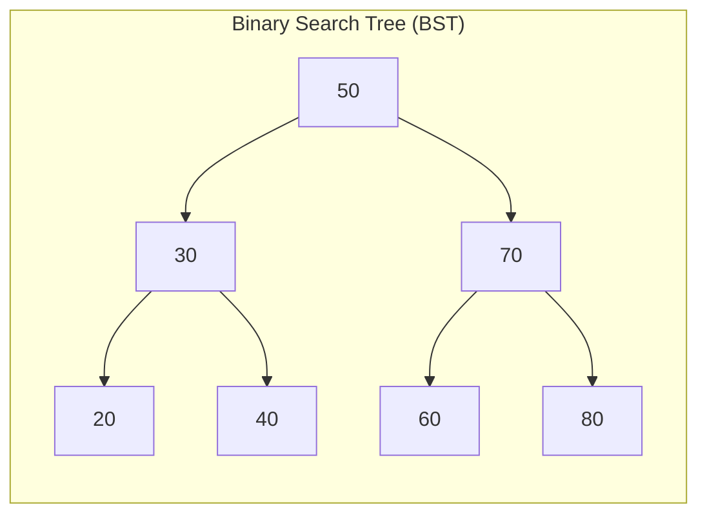
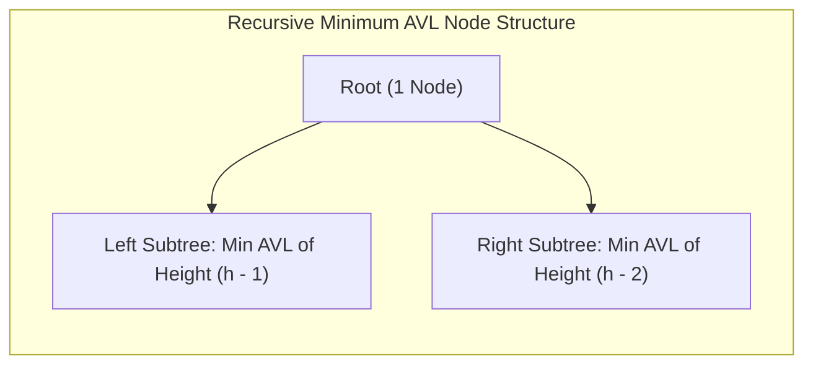

# 05. Binary Search Trees & AVL Trees

A **Binary Search Tree (BST)** is a binary tree structured to enable efficient searching, insertion, and deletion. An **AVL Tree** is a height-balanced BST that prevents worst-case degeneration. In GATE, questions test **inorder properties**, **deletion replacement cases**, **preorder validation algorithms**, **AVL rotation types**, and **minimum node recurrences**.

---

## 1. Binary Search Tree (BST) Architecture

### 1.1 The BST Ordering Property
For every node $X$ in a BST:

$$ \forall y \in \text{LeftSubtree}(X): \quad \text{key}(y) < \text{key}(X) $$

$$ \forall z \in \text{RightSubtree}(X): \quad \text{key}(z) > \text{key}(X) $$

> [!IMPORTANT]
> **The Golden Inorder Theorem of BST**:
> An **Inorder Traversal (Left-Root-Right)** of any valid Binary Search Tree **always produces keys in strictly ascending sorted order**.
>
> For the tree above: Inorder $\implies \langle 20, 30, 40, 50, 60, 70, 80 \rangle$.
> If an exam question asks: *"Can a sequence be the inorder traversal of a BST?"*, it is valid if and only if the sequence is **strictly monotonically increasing**.

---

## 2. BST Operations & Complexities

| Operation | Average Case (Balanced) | Worst Case (Skewed) |
| :--- | :---: | :---: |
| **Search** | $\mathcal{O}(\log n)$ | $\mathcal{O}(n)$ |
| **Insert** | $\mathcal{O}(\log n)$ | $\mathcal{O}(n)$ |
| **Delete** | $\mathcal{O}(\log n)$ | $\mathcal{O}(n)$ |
| **Find Minimum / Maximum** | $\mathcal{O}(\log n)$ | $\mathcal{O}(n)$ |

---

### 2.1 Insertion in a BST
- A new key is always inserted as a **leaf node**.
- For a fixed insertion sequence of $n$ distinct keys, the resulting BST is **unique**.
- Total number of distinct BSTs that can be formed using $n$ distinct keys is given by the **Catalan Number**:

$$ C_n = \frac{1}{n + 1} \binom{2n}{n} $$

---

### 2.2 Deletion in a BST (3 Cases)

| Deletion Scenario | Structural Condition | Deletion Procedure | Complexity |
| :--- | :--- | :--- | :---: |
| **Case 1: Leaf Node** | Node has $0$ children | Sever parent link directly (set parent pointer to `NULL`). | $\mathcal{O}(1)$ |
| **Case 2: Single Child** | Node has exactly $1$ child | Bypass the node: link parent of node directly to its child. | $\mathcal{O}(1)$ |
| **Case 3: Two Children** | Node has $2$ children | Copy **Inorder Predecessor** (max in left subtree) or **Inorder Successor** (min in right subtree) into node; recursively delete that replacement node. | $\mathcal{O}(h)$ |

> [!TIP]
> **Why Case 3 Always Succeeds**:
> The Inorder Predecessor (maximum node in the left subtree) is reached by going left once, then all the way right. Therefore, it **cannot have a right child**! It has at most 1 child, reducing the secondary deletion to trivial Case 1 or Case 2.

---

## 3. AVL Trees (Adelson-Velsky & Landis)

An **AVL Tree** is a self-balancing binary search tree where the heights of the two child subtrees of any node differ by at most one.

### 3.1 Balance Factor (BF)
For every node $X$ in an AVL tree:

$$ \boxed{\text{BF}(X) = \text{Height}(\text{LeftSubtree}) - \text{Height}(\text{RightSubtree}) \in \{-1, \; 0, \; +1\}} $$

If insertion of a node causes $\text{BF}(X) \notin \{-1, 0, +1\}$, the tree is rebalanced using **tree rotations**.

---

### 3.2 AVL Rebalancing Rotations (4 Scenarios)

| Critical Node Imbalance | Cause of Imbalance | Restoring Rotation Required | Number of Single Rotations |
| :--- | :--- | :--- | :---: |
| **LL Imbalance** | Inserted into **left** subtree of **left** child | **Single Right Rotation** about critical node | 1 |
| **RR Imbalance** | Inserted into **right** subtree of **right** child | **Single Left Rotation** about critical node | 1 |
| **LR Imbalance** | Inserted into **right** subtree of **left** child | **Left Rotation** on child, then **Right Rotation** on critical node | 2 |
| **RL Imbalance** | Inserted into **left** subtree of **right** child | **Right Rotation** on child, then **Left Rotation** on critical node | 2 |

---

### 3.3 Minimum Number of Nodes $N(h)$ in an AVL Tree

What is the minimum number of nodes required to construct an AVL tree of height $h$?

#### Recurrence Relation:
To minimize nodes, the root's two subtrees must differ in height by the maximum allowed balance factor ($1$):

$$ \boxed{N(h) = N(h - 1) + N(h - 2) + 1} $$

- **Base Cases**:
  - Height $0$ (single node): $N(0) = 1$
  - Height $1$ ($2$ nodes): $N(1) = 2$

#### Node Count Sequence:

$$
\begin{aligned}
N(0) &= 1 \\
N(1) &= 2 \\
N(2) &= N(1) + N(0) + 1 = 2 + 1 + 1 = 4 \\
N(3) &= N(2) + N(1) + 1 = 4 + 2 + 1 = 7 \\
N(4) &= N(3) + N(2) + 1 = 7 + 4 + 1 = 12 \\
N(5) &= N(4) + N(3) + 1 = 12 + 7 + 1 = 20 \\
N(6) &= N(5) + N(4) + 1 = 20 + 12 + 1 = 33
\end{aligned}
$$

#### Fibonacci Relation:

$$ \boxed{N(h) = F_{h + 3} - 1} $$

where $F_1 = 1, F_2 = 1, F_3 = 2, F_4 = 3, F_5 = 5, F_6 = 8, F_7 = 13, \dots$

#### Maximum Height for $n$ Nodes:

$$ h_{\max} \approx 1.44 \log_2(n + 2) - 0.328 \in \mathcal{O}(\log n) $$

---

## 4. Real Recent GATE Solved Problems

???+ example "GATE 2026 CS2 Q.49: BST Key Comparison Properties"
    **Question**: Consider a binary search tree (BST) with $n$ leaf nodes ($n > 0$). Given any node $V$, the key present in the node is denoted by $\text{key}(V)$. Let $U$ be an internal node and $W$ be a leaf node in the BST such that $W$ is a descendant of $U$. Which of the following statements is/are TRUE?
    - (I) If $W$ is in the left subtree of $U$, then $\text{key}(W) < \text{key}(U)$.
    - (II) The minimum element in a BST is always a leaf node.
    
    **Solution**:
    - Statement (I): By the defining property of a BST, every key in the left subtree of $U$ is strictly less than $\text{key}(U)$. Since $W$ is a descendant in the left subtree, $\text{key}(W) < \text{key}(U)$ is always **TRUE**.
    - Statement (II): Consider a BST where the root has no left child, but has a right child (e.g., root is $10$, right child is $20$). Here, $10$ is the minimum element, but it is an internal node (degree 1), NOT a leaf node! Hence, Statement (II) is **FALSE**.
    - **Conclusion**: (I) is TRUE, (II) is FALSE.

---

??? example "GATE 2026 CS1 Q.40: Distinct BST Count"
    **Question**: Let $P = \{1, 2, 3, 4\}$. How many distinct binary search trees can be formed using the elements of $P$?
    
    **Solution**:
    - The number of distinct BSTs with $n$ distinct keys is given by the $n$-th Catalan number $C_n$:

    $$ C_4 = \frac{1}{4 + 1} \binom{2 \times 4}{4} = \frac{1}{5} \binom{8}{4} = \frac{1}{5} \times \frac{8 \times 7 \times 6 \times 5}{4 \times 3 \times 2 \times 1} = \frac{70}{5} = 14 $$

    - **Answer**: `14`.
