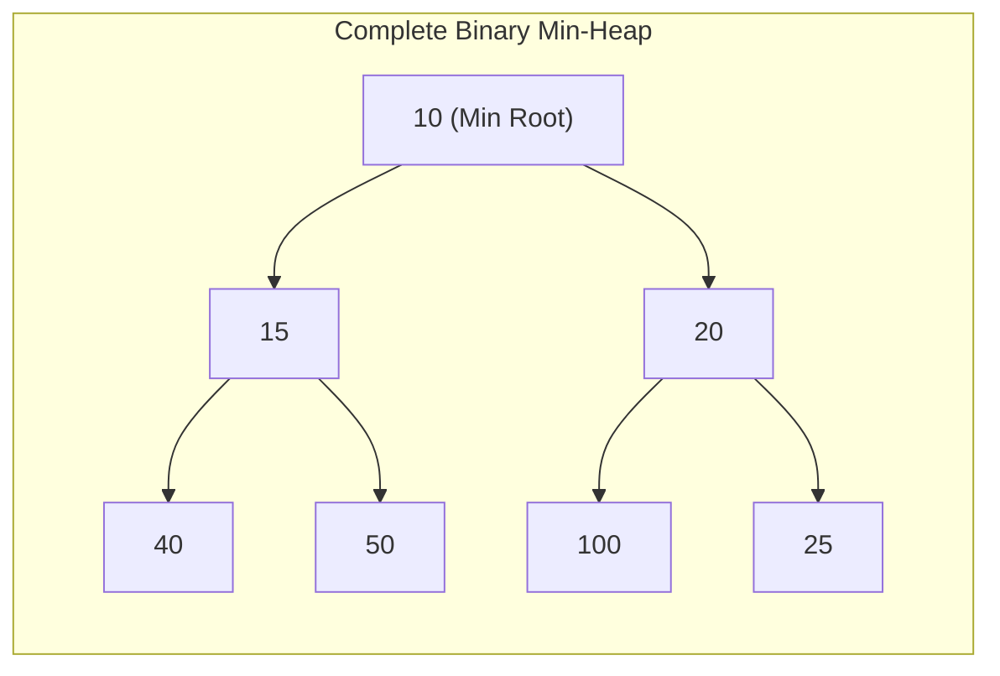

# 06. Binary Heaps & Priority Queues

A **Binary Heap** is a specialized Complete Binary Tree that provides optimal priority queue functionality. In recent GATE CS exams (2024, 2025, 2026), heaps are featured prominently through questions testing **leaf node index intervals**, **maximum element placement in min-heaps**, and the **$\mathcal{O}(n)$ build-heap proof**.

---

## 1. Binary Heap Architecture

A Binary Heap satisfies two concurrent structural properties:

1. **Shape Property (Complete Binary Tree)**:

   - All levels are completely filled with nodes, except possibly the bottom-most level.
   - At the bottom level, all nodes are filled strictly from **left to right**.
   - Consequence: Height of a heap with $n$ nodes is always $h = \lfloor \log_2 n \rfloor$.
2. **Heap Order Property**:

   - **Max-Heap**: For every node $i$, $\text{key}(\text{parent}(i)) \ge \text{key}(i)$. The maximum element is at the root.
   - **Min-Heap**: For every node $i$, $\text{key}(\text{parent}(i)) \le \text{key}(i)$. The minimum element is at the root.

---

## 2. Array Representation & Index Formulas

Because a binary heap is a Complete Binary Tree, it can be mapped into a 1D array **without any pointer overhead**.

### 2.1 Index Formulas Table

| Node Relationship | 0-Indexed Array Formula | 1-Indexed Array Formula |
| :--- | :---: | :---: |
| **Parent of node $i$** | $\lfloor \frac{i - 1}{2} \rfloor$ | $\lfloor \frac{i}{2} \rfloor$ |
| **Left Child of node $i$** | $2i + 1$ | $2i$ |
| **Right Child of node $i$** | $2i + 2$ | $2i + 1$ |
| **Internal Nodes Range** | $\left[0, \; \lfloor \frac{n}{2} \rfloor - 1\right]$ | $\left[1, \; \lfloor \frac{n}{2} \rfloor\right]$ |
| **Leaf Nodes Range** | $\left[\lfloor \frac{n}{2} \rfloor, \; n - 1\right]$ | $\left[\lfloor \frac{n}{2} \rfloor + 1, \; n\right]$ |

---

## 3. The Golden Min-Heap / Max-Heap Location Theorems

> [!IMPORTANT]
> **Maximum Element in a Min-Heap (GATE 2026 CS1 Q.23 & GATE 2024 CS1 Q.43)**:
> In a Binary Min-Heap:
> - Every internal node has a key strictly $\le$ the keys of its children.
> - Therefore, **an internal node can NEVER contain the maximum element of the heap**.
> - The maximum element **MUST reside at one of the leaf nodes**.
> - For an array of size $n$ (0-indexed), the index $k$ of the maximum element must satisfy:
> 
> $$ \boxed{\left\lfloor \frac{n}{2} \right\rfloor \le k \le n - 1} $$
>
> *(Similarly, in a Max-Heap, the **minimum element** must reside among the leaf nodes in the interval $[\lfloor n/2 \rfloor, n - 1]$).*

---

## 4. Heap Operations & Complexities

### 4.1 Summary of Operations

| Operation | Description | Time Complexity |
| :--- | :--- | :---: |
| `findMin()` / `findMax()` | Access the root element at index $0$ | $\mathcal{O}(1)$ |
| `insert(x)` | Append to bottom, then percolate-up (swim) | $\mathcal{O}(\log n)$ |
| `deleteMin()` / `deleteMax()` | Replace root with last leaf, then percolate-down (sink) | $\mathcal{O}(\log n)$ |
| `buildHeap(A)` | Heapifies an arbitrary array from bottom-up | **$\mathcal{O}(n)$** |
| `HeapSort(A)` | Build heap + $n$ extractions | $\mathcal{O}(n \log n)$ |

---

### 4.2 Rigorous Proof: Why `buildHeap` Takes $\mathcal{O}(n)$ Time

A naive analysis suggests $n$ insertions take $n \times \mathcal{O}(\log n) = \mathcal{O}(n \log n)$. However, bottom-up `buildHeap` calls `heapify()` starting from the last internal node $\lfloor n/2 \rfloor - 1$ down to the root $0$.

| Tree Level / Height ($h$) | Number of Nodes at Height $h$ | Max Sink Steps per Node | Total Work at Level |
| :---: | :---: | :---: | :---: |
| **Height $0$ (Leaves)** | $\lceil n / 2 \rceil$ | $0$ (No sinking needed) | $0$ |
| **Height $1$** | $\lceil n / 4 \rceil$ | $1$ step | $\frac{n}{4} \times 1$ |
| **Height $2$** | $\lceil n / 8 \rceil$ | $2$ steps | $\frac{n}{8} \times 2$ |
| $\dots$ | $\dots$ | $\dots$ | $\dots$ |
| **Height $h$** | $\le \lceil n / 2^{h+1} \rceil$ | $h$ steps | $\frac{n}{2^{h+1}} \times h$ |
| **Height $\lfloor \log_2 n \rfloor$ (Root)** | $1$ node | $\lfloor \log_2 n \rfloor$ steps | $1 \times \log_2 n$ |

#### Step-by-Step Proof:

- Number of nodes at height $h$ in a CBT of size $n$: $\le \lceil \frac{n}{2^{h+1}} \rceil$.
- Sinking a node at height $h$ requires at most $h$ comparisons.
- Total operations $T(n)$:
    $$ T(n) = \sum_{h=0}^{\lfloor \log_2 n \rfloor} \frac{n}{2^{h+1}} \cdot h = \frac{n}{2} \sum_{h=0}^{\lfloor \log_2 n \rfloor} \frac{h}{2^h} $$

- The infinite geometric-arithmetic series is a known mathematical constant:
    $$ \sum_{h=0}^{\infty} \frac{h}{2^h} = \frac{1/2}{(1 - 1/2)^2} = \frac{1/2}{1/4} = 2 $$

- Therefore:
    $$ T(n) \le \frac{n}{2} \times 2 = \mathbf{\mathcal{O}(n)} \quad \blacksquare $$

---

## 5. Real Recent GATE Solved Problems

???+ example "GATE 2026 CS1 Q.23: Index of Maximum in a Min-Heap"
    **Question**: Let $n$ be an odd number greater than $100$. Consider a binary min-heap with $n$ elements stored in an array $P$ whose indices range from $0$ to $n - 1$. Let $k$ be the index of the maximum element in $P$. Which of the following inequalities correctly specifies the range of $k$?

    - (A) $0 \le k \le \lfloor n/2 \rfloor$
    - (B) $\lfloor n/2 \rfloor \le k \le n - 1$
    - (C) $0 \le k \le \lfloor \log_2 n \rfloor$
    - (D) $\lfloor n/4 \rfloor \le k \le \lfloor n/2 \rfloor$

    **Solution**:

    - In a binary min-heap, the children of any node are always greater than or equal to their parent.
    - Thus, no internal node can hold the maximum element.
    - The maximum element must be located at one of the leaf nodes.
    - For a 0-indexed array of size $n$, the leaf nodes begin at index $\lfloor n/2 \rfloor$ and extend to $n - 1$.
    - **Correct Option**: **(B) $\lfloor n/2 \rfloor \le k \le n - 1$**.

---

??? example "GATE 2024 CS1 Q.41: Array Heapification"
    **Question**: An array $[82, 101, 90, 11, 111, 75, 33, 131, 44, 93]$ is heapified into a max-heap. What is the value at index $0$ after heapification?
    
    **Solution**:
    
    - In any valid max-heap, the root (index $0$) must contain the global maximum of all elements.
    - The elements are: $\{82, 101, 90, 11, 111, 75, 33, 131, 44, 93\}$.
    - The largest element in the set is $131$.
    - After max-heapification, $131$ must be promoted to the root (index $0$).
    - **Answer**: `131`.
