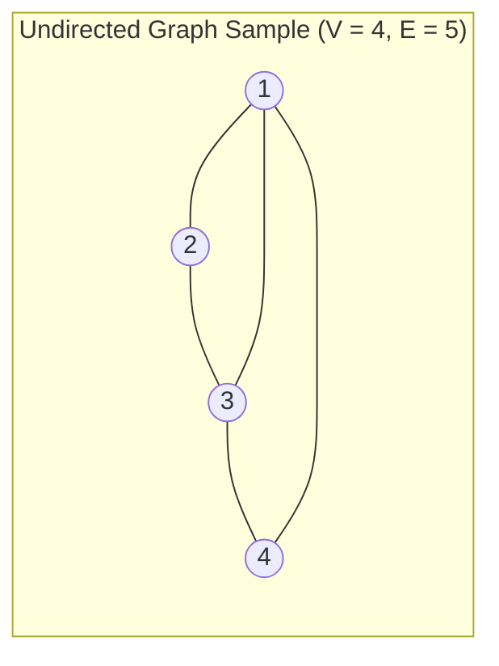
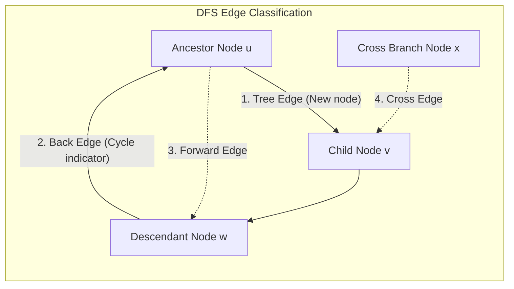

# 07. Graph Representations & Traversals

A **Graph** $G = (V, E)$ is a non-linear data structure consisting of a set of vertices (nodes) and edges connecting them. In the GATE examination, this topic is tested through **space complexity of graph representations**, **BFS vs. DFS mechanics**, **DFS edge classifications**, and **topological sorting algorithms**.

---

## 1. Graph Fundamentals & The Handshaking Lemma



### 1.1 The Handshaking Lemma (Undirected Graphs)
In any undirected graph $G = (V, E)$, the sum of degrees of all vertices equals twice the number of edges:
$$ \boxed{\sum_{v \in V} \text{deg}(v) = 2|E|} $$

> [!IMPORTANT]
> **Golden Corollary (Tested in GATE)**:
> In any undirected graph, the **number of vertices having an odd degree is always EVEN**.
>
> **Proof**:
> Split vertices into odd-degree set $V_{\text{odd}}$ and even-degree set $V_{\text{even}}$:
> 
> $$ \sum_{v \in V_{\text{odd}}} \text{deg}(v) + \sum_{u \in V_{\text{even}}} \text{deg}(u) = 2|E| $$
> 
> Since $2|E|$ is even and the second sum is even, the first sum $\sum_{v \in V_{\text{odd}}} \text{deg}(v)$ must be **even**. The sum of odd numbers can only be even if the number of terms is **even**!

---

## 2. Graph Representations Comparison
The two primary data structures used to store and manipulate graphs in memory are the **Adjacency Matrix** (dense) and the **Adjacency List** (sparse).

| Operation / Metric | Adjacency Matrix | Adjacency List |
| :--- | :---: | :---: |
| **Space Complexity** | $\Theta(V^2)$ | $\mathbf{\Theta(V + E)}$ |
| **Check if Edge $(u, v)$ Exists** | $\mathbf{\mathcal{O}(1)}$ | $\mathcal{O}(\text{deg}(u))$ |
| **Find All Neighbors of Vertex $u$** | $\mathcal{O}(V)$ | $\mathbf{\mathcal{O}(\text{deg}(u))}$ |
| **Insert a New Edge** | $\mathcal{O}(1)$ | $\mathcal{O}(1)$ |
| **Delete an Edge** | $\mathcal{O}(1)$ | $\mathcal{O}(\text{deg}(u))$ |
| **Add a New Vertex** | $\mathcal{O}(V^2)$ *(requires matrix reallocation)* | $\mathcal{O}(1)$ |

---

## 3. Breadth-First Search (BFS) vs. Depth-First Search (DFS)

### 3.1 Comparison of BFS and DFS

| Metric / Property | Breadth-First Search (BFS) | Depth-First Search (DFS) |
| :--- | :--- | :--- |
| **Underlying Data Structure** | **Queue (FIFO)** | **Stack (LIFO)** or Recursion |
| **Time Complexity (Adjacency List)** | $\mathcal{O}(V + E)$ | $\mathcal{O}(V + E)$ |
| **Time Complexity (Adjacency Matrix)**| $\mathcal{O}(V^2)$ | $\mathcal{O}(V^2)$ |
| **Auxiliary Space Complexity** | $\mathcal{O}(V)$ *(Width of graph)* | $\mathcal{O}(V)$ *(Depth / Height of recursion)* |
| **Shortest Path (Unweighted Graph)** | **Guaranteed Optimal** | Not guaranteed |
| **Key Applications** | Shortest path, Bipartite graph check, Connected components | Cycle detection, Topological sort, Strongly Connected Components (SCC) |

---

## 4. DFS Edge Classification & Cycle Detection

When running DFS on a directed graph, every edge $(u, v)$ falls into one of four distinct categories:



| Edge Category | Directed Endpoints ($u \to v$) | Discovery Condition in DFS | Structural Implication |
| :--- | :--- | :--- | :--- |
| **Tree Edge** | Parent $\to$ Child | Visits a previously unvisited vertex | Form edges of the DFS spanning tree |
| **Back Edge** | Descendant $\to$ Ancestor | Connects back to an active ancestor on recursion stack | **Guarantees presence of a cycle!** |
| **Forward Edge** | Ancestor $\to$ Descendant | Connects to an already finished non-child descendant | Shortcut path in the DFS tree |
| **Cross Edge** | Branch $\to$ Branch | Connects to an already processed node in another subtree | Cross-branch link |

> [!CAUTION]
> **Cycle Detection Theorem in Directed Graphs**:
> A directed graph contains a cycle **IF AND ONLY IF** a DFS traversal of the graph produces at least one **Back Edge**.

---

## 5. Topological Sorting (DAGs Only)

A **Topological Sort** of a Directed Acyclic Graph (DAG) is a linear permutation of vertices such that for every directed edge $(u, v)$, vertex $u$ appears before $v$ in the ordering.

- **Prerequisite**: Graph **must be a DAG** (Directed Acyclic Graph). If a graph has a cycle, no valid topological order exists!

### 5.1 Kahn's Algorithm (Indegree / BFS-Based)
```c title="kahns_algorithm.c" linenums="1"
1. Compute in-degree of all V vertices: O(V + E)
2. Enqueue all vertices with in-degree == 0
3. While queue is not empty:
   - u = dequeue()
   - Append u to topological sort output
   - For each neighbor v of u:
       decrement in-degree[v]
       if in-degree[v] == 0: enqueue(v)
4. If count of output nodes != V -> Graph contains a CYCLE!
```

- **Time Complexity**: $\mathcal{O}(V + E)$
- **Space Complexity**: $\mathcal{O}(V)$

---

## 6. Real Recent GATE Solved Problems

???+ example "GATE Exam Problem: Minimum Edges for Connected Component"
    **Question**: What is the minimum number of edges in a connected undirected graph with $n$ vertices?
    - (A) $n$
    - (B) $n - 1$
    - (C) $n(n - 1)/2$
    - (D) $\log_2 n$
    
    **Solution**:

    - A connected undirected graph with minimum edges is a **Tree**.
    - Any tree with $n$ vertices contains exactly $n - 1$ edges.
    - Removing any edge disconnects the graph into two components.
    - **Correct Option**: **(B) $n - 1$**.

---

??? example "GATE Practice: Connected Components using Traversals"
    **Question**: An undirected graph has 10 vertices and 3 connected components. What is the maximum possible number of edges in this graph?
    
    **Solution**:

    - Let component sizes be $n_1, n_2, n_3$ where $n_1 + n_2 + n_3 = 10$ and $n_i \ge 1$.
    - Number of edges in component $i$ is maximized when it is a complete graph: $\binom{n_i}{2} = \frac{n_i(n_i - 1)}{2}$.
    - To maximize the sum of squares, make one component as large as possible:
    $$ n_1 = 8, \quad n_2 = 1, \quad n_3 = 1 $$

    - Maximum edges:
    $$ \binom{8}{2} + \binom{1}{2} + \binom{1}{2} = \frac{8 \times 7}{2} + 0 + 0 = 28 $$

    - **Answer**: `28 edges`.
