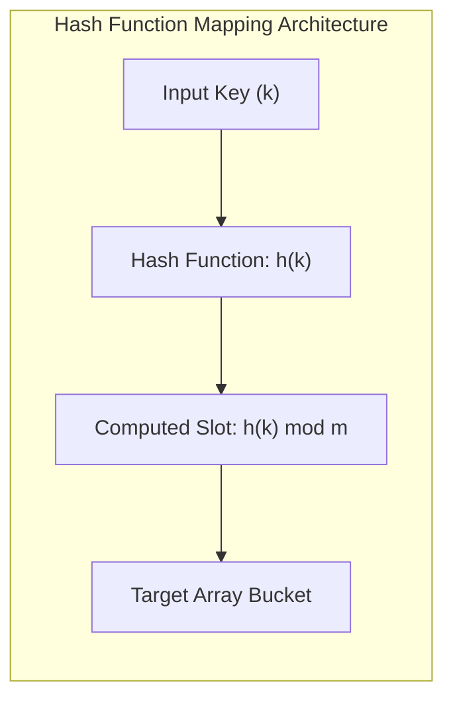

# 08. Hashing & Collision Resolution

**Hashing** is an effective technique to implement the **Dictionary ADT** (supporting `insert`, `search`, and `delete`) in $\mathcal{O}(1)$ average time. In the GATE examination, this topic is tested through **probing sequence traces (linear, quadratic, double hashing)**, **clustering phenomena**, and **load factor ($\alpha$) formulas**.

---

## 1. Hash Functions & Load Factor

A hash function $h(k)$ maps a massive universe of keys $U$ into a finite range of table indices $\{0, 1, \dots, m - 1\}$.

$$ \boxed{\text{Load Factor } \alpha = \frac{n}{m} = \frac{\text{Number of elements stored}}{\text{Total table capacity}}} $$

### 1.1 Standard Hash Functions

- **Division Method**: $h(k) = k \pmod{m}$  
  *(Rule: $m$ should be a prime number not close to a power of $2$ or $10$.)*
- **Multiplication Method**: $h(k) = \lfloor m \cdot (k \cdot A \pmod{1}) \rfloor$  
  *(Knuth recommends the Golden Ratio constant: $A = \frac{\sqrt{5} - 1}{2} \approx 0.6180339887$.)*
- **Mid-Square Method**: Square the key ($k^2$) and extract a predetermined number of middle bits.
- **Folding Method**: Partition the key into equal-sized chunks and sum them together.

---

## 2. Collision Resolution Techniques

When two distinct keys $k_1 \neq k_2$ produce $h(k_1) = h(k_2)$, a **collision** occurs.

| Strategy | Technique Family | Storage Mechanism | Load Factor ($\alpha$) Bound |
| :--- | :--- | :--- | :---: |
| **Separate Chaining** | Open Hashing | Elements placed in linked lists external to hash table | $\alpha$ can exceed $1.0$ |
| **Linear Probing** | Closed Hashing (Open Addressing) | Probes $(h'(k) + i) \pmod{m}$ sequentially inside table array | Strictly $\alpha \le 1.0$ (Causes Primary Clustering) |
| **Quadratic Probing** | Closed Hashing (Open Addressing) | Probes $(h'(k) + c_1 i + c_2 i^2) \pmod{m}$ | Strictly $\alpha \le 1.0$ (Causes Secondary Clustering) |
| **Double Hashing** | Closed Hashing (Open Addressing) | Probes $(h_1(k) + i \cdot h_2(k)) \pmod{m}$ with step offset $h_2(k)$ | Strictly $\alpha \le 1.0$ (Free from Clustering) |

---

## 3. Open Addressing Probing Strategies

In Open Addressing, when collision occurs, we probe alternate slots in sequence: $h(k, i)$ for probe iteration $i = 0, 1, 2, \dots, m - 1$.

### 3.1 Comparison of Open Addressing Methods

| Probing Strategy | Formula $h(k, i)$ | Clustering Behavior | Traversal Coverage Guarantee |
| :--- | :---: | :--- | :--- |
| **Linear Probing** | $(h'(k) + i) \pmod{m}$ | **Primary Clustering**: Contiguous filled slots merge into large blocks, degrading performance. | Always visits all $m$ slots. |
| **Quadratic Probing** | $(h'(k) + c_1 i + c_2 i^2) \pmod{m}$ | **Secondary Clustering**: Keys with identical initial hash follow identical probe trails. | Guarantees $\ge \lceil m/2 \rceil$ slots if $m$ is prime and $c_1 = c_2 = 1/2$. |
| **Double Hashing** | $(h_1(k) + i \cdot h_2(k)) \pmod{m}$ | **Optimal**: Free from both primary and secondary clustering. | Visits all $m$ slots if $\gcd(h_2(k), m) = 1$. |

> [!IMPORTANT]
> **Condition for Double Hashing Full Table Coverage**:
> The offset function $h_2(k)$ must be relatively prime to the table size $m$:
> 
> $$ \gcd(h_2(k), m) = 1 $$
> 
> Typically, $m$ is chosen as a prime number and $h_2(k) = 1 + (k \bmod (m - 1))$, ensuring $1 \le h_2(k) \le m - 1$.

---

## 4. Theoretical Search Cost under Uniform Hashing

Assuming uniform distribution of keys across slots:

| Operational Mode | Separate Chaining | Open Addressing (Uniform Hashing) |
| :--- | :---: | :---: |
| **Successful Search Probes** | $1 + \frac{\alpha}{2}$ | $\frac{1}{\alpha} \ln \left(\frac{1}{1 - \alpha}\right)$ |
| **Unsuccessful Search Probes** | $1 + \alpha$ | $\frac{1}{1 - \alpha}$ |
| **Worst-Case Search Time** | $\mathcal{O}(n)$ | $\mathcal{O}(n)$ |

---

## 5. Real Recent GATE Solved Problems

???+ example "GATE Exam Problem: Linear Probing Simulation"
    **Question**: Given a hash table of size $m = 7$ with initial keys empty.
    Hash function: $h(k) = k \bmod 7$.
    Collision resolution: **Linear Probing**.
    Insert the following keys in order: $\langle 10, 20, 15, 30, 22 \rangle$.
    What is the final index of key $22$?

    **Step-by-step Insertion Trace**:
    - Insert $10$: $10 \bmod 7 = 3 \implies$ Slot $3$ is empty $\to$ **Stored at Slot 3**.
    - Insert $20$: $20 \bmod 7 = 6 \implies$ Slot $6$ is empty $\to$ **Stored at Slot 6**.
    - Insert $15$: $15 \bmod 7 = 1 \implies$ Slot $1$ is empty $\to$ **Stored at Slot 1**.
    - Insert $30$: $30 \bmod 7 = 2 \implies$ Slot $2$ is empty $\to$ **Stored at Slot 2**.
    - Insert $22$:
      - Probe $0$: $22 \bmod 7 = 1$ (Occupied by $15$, collision!).
      - Probe $1$: $(1 + 1) \bmod 7 = 2$ (Occupied by $30$, collision!).
      - Probe $2$: $(1 + 2) \bmod 7 = 3$ (Occupied by $10$, collision!).
      - Probe $3$: $(1 + 3) \bmod 7 = 4$ (Empty!).
      - $\implies$ **Stored at Slot 4**.

    **Final Table State**:
    - Slot 0: Empty
    - Slot 1: `15`
    - Slot 2: `30`
    - Slot 3: `10`
    - Slot 4: `22`
    - Slot 5: Empty
    - Slot 6: `20`

    **Answer**: Key $22$ is placed at **Index 4**.
