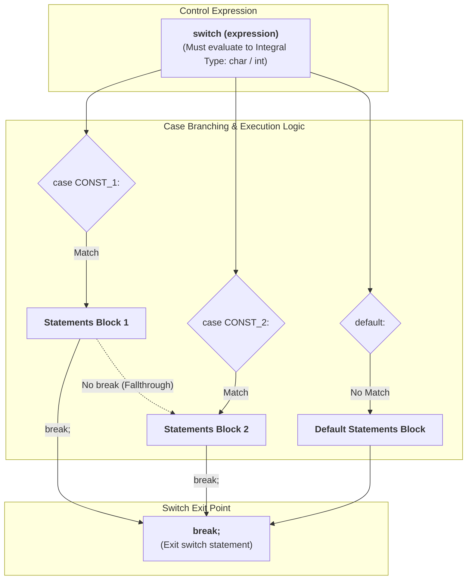
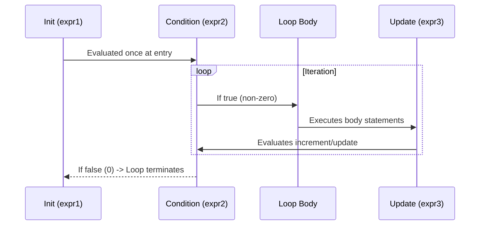

# 02. Control Flow & Loops

Control flow constructs dictate the execution trajectory of a C program. In GATE, questions in this area test **dangling-else ambiguities**, **switch fallthrough mechanics**, **loop termination conditions**, and **subtle differences between `break` and `continue`**.

---

## 1. Selection Statements

Selection statements allow conditional branching based on the truth value of an expression.

### 1.1 The Dangling Else Problem
In C, when multiple `if` statements are nested without braces `{ }`, the `else` clause is syntactically matched with the **nearest preceding unclosed `if`**.

```c title="dangling_else.c" linenums="1"
#include <stdio.h>

int main() {
    int a = 1, b = 0;
    
    // Code with deceptive indentation:
    if (a == 1)
        if (b == 1)
            printf("Both are 1\n");
    else
        printf("a is NOT 1\n"); // TRAP! This else belongs to (b == 1)!
        
    return 0;
}
```

> [!WARNING]
> **GATE Insight: Indentation is Ignored by the Compiler**
> The `else` belongs to `if (b == 1)`, not `if (a == 1)`.
> Since `a == 1` is true but `b == 1` is false, control enters the outer `if`, fails the inner `if`, and executes the inner `else` branch, printing `"a is NOT 1"`.
> To associate the `else` with the outer `if`, explicit compound statement braces `{ }` must be used.

---

### 1.2 Switch-Case Statements & Rules

The `switch` statement facilitates multi-way branching against integral constants.



#### Strict C Standards for `switch`:
1. **Expression Type**: Must evaluate to an **integral type** (`char`, `short`, `int`, `long`, `enum`). Floating-point types (`float`, `double`) and strings (`char*`) are strictly forbidden.
2. **Case Labels**: Must be **compile-time constant integer expressions** (e.g., `case 1 + 2:`, `case 'A':`). Variable expressions like `case x:` are compilation errors.
3. **Duplicate Labels**: No two `case` labels in the same `switch` block may have identical values.
4. **The `default` Label**: Optional. Executes if no `case` matches. It can appear **anywhere** inside the `switch` block (at the beginning, middle, or end). If it lacks a `break;` and appears first, it will fall through to subsequent cases!
5. **Fallthrough Mechanics**: If a matching case does not terminate with `break;`, execution continues sequentially into the statements of subsequent cases, completely ignoring their case conditions until a `break;` or the closing brace `}` is encountered.

???+ example "GATE Problem: Switch Placement & Fallthrough"
    **Question**: What is the output of the following C code?
    ```c
    #include <stdio.h>
    int main() {
        int val = 2;
        switch (val) {
            default:
                printf("Def ");
            case 1:
                printf("One ");
                break;
            case 2:
                printf("Two ");
            case 3:
                printf("Three ");
                break;
            case 4:
                printf("Four ");
        }
        return 0;
    }
    ```
    **Solution**:
    1. `val = 2` matches `case 2:`.
    2. `"Two "` is printed.
    3. Notice there is **no `break;`** after `case 2:`. Control falls through to `case 3:`.
    4. `"Three "` is printed.
    5. A `break;` is encountered after `case 3:`, exiting the switch.
    6. Final Output: `Two Three `.

---

## 2. Iterative Statements (Loops)

C provides three looping constructs with distinct control properties.

| Feature | `for` loop | `while` loop | `do-while` loop |
| :--- | :--- | :--- | :--- |
| **Control Type** | Entry-Controlled | Entry-Controlled | **Exit-Controlled** |
| **Minimum Iterations** | $0$ | $0$ | **$1$ (Guaranteed)** |
| **Semicolon at End** | No | No | **Yes** (`while(cond);`) |
| **Primary Use** | Counted / Index-driven | Condition-driven | Prompt / at-least-once logic |

### 2.1 The `for` Loop Anatomy

$$ \text{for} \; (\underbrace{\text{expr}_1}_{\text{initialization}}; \; \underbrace{\text{expr}_2}_{\text{condition}}; \; \underbrace{\text{expr}_3}_{\text{iteration}}) \; \text{statement;} $$



- **Expression Omission**:
  - All three expressions can be omitted independently.
  - `for (;;)` creates an unconditional **infinite loop** (equivalent to `while (1)`).
  - If `expr_2` is omitted, it defaults to non-zero (`true`).
- **Comma Operator in Loops**:
  ```c
  for (i = 0, j = 10; i < j; i++, j--) {
      // Multiple initializations and updates executed left to right
  }
  ```

---

## 3. Jump Statements: `break` vs. `continue`

| Property | `break` | `continue` |
| :--- | :--- | :--- |
| **Target Scope** | Innermost `switch`, `for`, `while`, or `do-while` | Innermost `for`, `while`, or `do-while` (NOT `switch`) |
| **Action** | Immediately **terminates** the loop/switch | Skips remainder of loop body and begins **next iteration** |
| **Where control transfers in `for` loop** | First statement **outside** the loop | Transfers directly to **`expr_3` (the update expression)** |
| **Where control transfers in `while` loop** | First statement **outside** the loop | Transfers directly to **test condition** |

> [!CAUTION]
> **GATE Trap: `continue` in `while` vs `for`**
> In a `while` loop, if the loop counter increment is written at the bottom of the body, a `continue` statement will skip the increment, frequently triggering an **accidental infinite loop**:
> ```c
> int i = 0;
> while (i < 5) {
>     if (i == 2)
>         continue; // Skips i++ below -> i stays 2 forever! Infinite loop!
>     i++;
> }
> ```
> In a `for (int i = 0; i < 5; i++)`, `continue` jumps directly to `i++`, so `i` is safely incremented.

---

## 4. Real Recent GATE Solved Problems

???+ example "GATE 2025 CS2 Q.33: Tracing Euclidean GCD Algorithm in `do-while`"
    **Question**: Consider the following C program segment:
    ```c
    int x = 126, y = 105;
    do {
        int rem = x % y;
        x = y;
        y = rem;
    } while (y != 0);
    printf("%d", x);
    ```
    What is the value printed?

    **Step-by-step Trace Table**:
    This loop implements the classic Euclidean algorithm for Greatest Common Divisor ($\gcd(x, y)$).

    | Iteration | Entry $x$ | Entry $y$ | `rem = x % y` | New $x = y$ | New $y = \text{rem}$ | Condition `(y != 0)` |
    | :---: | :---: | :---: | :---: | :---: | :---: | :---: |
    | **1** | $126$ | $105$ | $126 \bmod 105 = 21$ | $105$ | $21$ | $21 \neq 0$ (True) |
    | **2** | $105$ | $21$ | $105 \bmod 21 = 0$ | $21$ | $0$ | $0 \neq 0$ (**False**) |

    When loop terminates, `x = 21`.
    **Output**: `21` (which is $\gcd(126, 105) = 21$).

---

??? example "GATE Practice: Semicolon Trap After Loop"
    **Question**: What is the output of the following program?
    ```c
    #include <stdio.h>
    int main() {
        int i;
        for (i = 0; i < 5; i++);
            printf("%d ", i);
        return 0;
    }
    ```
    **Solution**:
    
    - Notice the semicolon `;` immediately after `for (i = 0; i < 5; i++);`.
    - This semicolon constitutes a **null statement** as the loop body. The loop runs 5 times doing nothing.
    - Loop exits when condition `i < 5` fails, which occurs at `i = 5`.
    - The `printf` is outside the loop and executes exactly once.
    - **Output**: `5`.
