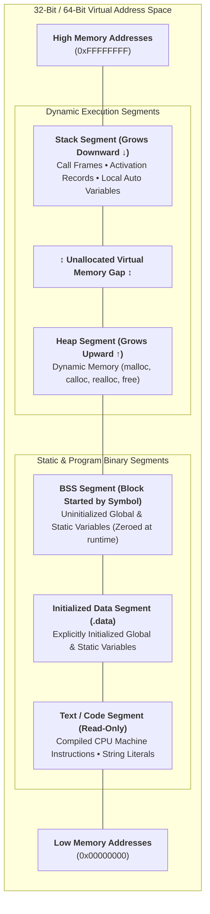

# 03. Functions, Scoping & Recursion

Functions, scoping rules, and recursion represent one of the highest-weightage topics in the GATE CS syllabus. Questions frequently require you to trace **activation records on the call stack**, evaluate **static vs. dynamic scoping**, and analyze **recursive functions containing static variables**.

---

## 1. Memory Organization of a C Program

The operating system maps an executable into virtual memory divided into distinct structural segments:



| Memory Segment | Lifetime | Read / Write Permission | Typical Contents |
| :--- | :--- | :--- | :--- |
| **Text (Code)** | Program execution | **Read-Only** | Binary CPU instructions, string literals (`"hello"`). |
| **Initialized Data** | Program execution | Read-Write | Global/static variables initialized to non-zero (e.g., `static int x = 10;`). |
| **BSS** | Program execution | Read-Write | Global/static variables initialized to zero or uninitialized (`static int y;`). |
| **Heap** | Until `free()` or exit | Read-Write | Dynamically allocated memory chunks via `malloc()`. |
| **Stack** | Function block scope | Read-Write | Function call frames, local auto variables, parameters. |

> [!NOTE]
> **GATE 2026 CS2 Q.17 Reference**:
> *"In C runtime environment, which one of the following is stored in heap?"*
> **Answer**: Memory dynamically requested at runtime through library calls like `malloc()`, `calloc()`, or `realloc()`.

---

## 2. Storage Classes in C

C provides 4 primary storage classes that dictate the **scope**, **visibility**, **lifetime**, and **memory location** of variables.

| Storage Class | Keyword | Storage Location | Default Value | Scope / Visibility | Lifetime |
| :--- | :--- | :--- | :--- | :--- | :--- |
| **Automatic** | `auto` | **Stack** | Garbage | Local to enclosing block | Block execution |
| **Register** | `register` | **CPU Register** | Garbage | Local to enclosing block | Block execution |
| **Static (Local)** | `static` | **Data Segment** | Zero (`0`) | Local to enclosing block | **Entire program runtime** |
| **Static (Global)** | `static` | **Data Segment** | Zero (`0`) | **Current file only** (Internal Linkage) | **Entire program runtime** |
| **External** | `extern` | **Data Segment** | Zero (`0`) | Global across all files (External Linkage) | **Entire program runtime** |

### Crucial Storage Class Rules:
1. **The `register` Keyword**: Serves as a performance recommendation to the compiler to store the variable directly in a CPU register. Because registers lack memory addresses, the **address-of operator `&` cannot be applied to a `register` variable** (e.g., `&reg_var` triggers a compile error).
2. **Local `static` Variables**: Initialized **only once** at load time. They persist and retain their updated values across multiple invocations of the function.

---

## 3. Scoping Rules: Static vs. Dynamic Scoping

Scoping rules determine how the compiler or interpreter resolves free / non-local variable names when functions are nested or called.

| Scoping Discipline | Name Resolution Mechanism | Resolution Time | Standard In |
| :--- | :--- | :---: | :--- |
| **Static (Lexical) Scoping** | Resolved based on physical source code block nesting | **Compile-Time** | C, C++, Java, Python, Go, Rust |
| **Dynamic Scoping** | Resolved based on the most recent caller's activation record on stack | **Runtime** | Classic Lisp, Bash, Perl (local) |


### Static vs. Dynamic Scoping Trace Problem

Consider the following program:
```c linenums="1"
int x = 10;

void print_val() {
    printf("%d\n", x);
}

void caller() {
    int x = 20;
    print_val();
}

int main() {
    caller();
    return 0;
}
```

=== "Static (Lexical) Scoping (C Standard)"
    - In `print_val()`, variable `x` is non-local.
    - Under static scoping, the compiler looks at the **lexical structure** where `print_val()` is declared.
    - The enclosing scope of `print_val()` is the global file scope, where `int x = 10;`.
    - **Output under Static Scoping**: `10`.

=== "Dynamic Scoping Simulation"
    - In `print_val()`, variable `x` is non-local.
    - Under dynamic scoping, the runtime searches the **call stack** backward starting from the caller of `print_val()`.
    - The immediate caller is `caller()`, which has a local variable `int x = 20;`.
    - **Output under Dynamic Scoping**: `20`.

---

## 4. Recursion & Activation Records

A function is recursive if it invokes itself either directly or indirectly. Every recursive invocation creates a new **Activation Record (Stack Frame)** containing:
1. Incoming parameters.
2. Return address back to the caller.
3. Saved frame pointer (`%ebp`/`%rbp`).
4. Local automatic variables.

$$ \text{Total Space Complexity} = (\text{Maximum Recursion Depth}) \times (\text{Stack Frame Size}) $$


### 4.1 Classifications of Recursion
- **Tail Recursion**: The recursive call is the very last operation performed before returning.
  ```c
  void tail_rec(int n) {
      if (n <= 0) return;
      printf("%d ", n);
      tail_rec(n - 1); // Tail call: nothing remains to compute after return
  }
  ```
  *Modern optimizing compilers perform **Tail Call Optimization (TCO)**, transforming tail recursion into a jump loop to achieve $\mathcal{O}(1)$ stack space.*
- **Non-Tail Recursion**: Operations are performed after the recursive call returns (e.g., standard factorial: `return n * fact(n - 1);`).
- **Tree Recursion**: A function makes multiple recursive calls per invocation (e.g., Fibonacci $F(n) = F(n - 1) + F(n - 2)$), generating an exponential recursion tree.
- **Nested Recursion**: A function passes a recursive call as an argument to another recursive call (e.g., Ackermann's Function).

---

## 5. Real Recent GATE Solved Problems

???+ example "GATE 2026 CS2 Q.60: Static Variables in Recursive Calls"
    **Question**: Consider the following ANSI-C program:
    ```c
    #include <stdio.h>

    int f(int n) {
        static int count = 0;
        if (n <= 0)
            return 1;
        count++;
        return f(n - 1) + f(n - 2) + count;
    }

    int main() {
        int val = f(3);
        printf("%d\n", val);
        return 0;
    }
    ```
    What is the value printed?

    **Step-by-step Trace**:
    The variable `count` is `static`, meaning a single shared memory location in the Data Segment is updated across **all** calls.

    Let us trace the calls in their exact execution order (left-to-right evaluation):

    1. Call $f(3)$:
       - `count` becomes $0 + 1 = 1$.
       - Needs: $f(2) + f(1) + \text{count}$.
    2. Sub-call $f(2)$ from $f(3)$:
       - `count` becomes $1 + 1 = 2$.
       - Needs: $f(1) + f(0) + \text{count}$.
    3. Sub-call $f(1)$ from $f(2)$:
       - `count` becomes $2 + 1 = 3$.
       - Needs: $f(0) + f(-1) + \text{count}$.
    4. Sub-call $f(0)$ from $f(1)$:
       - $n \le 0 \implies$ returns $1$. (`count` unchanged at 3).
    5. Sub-call $f(-1)$ from $f(1)$:
       - $n \le 0 \implies$ returns $1$. (`count` unchanged at 3).
       - $f(1)$ computes: $1 + 1 + 3 = 5$.
    6. Sub-call $f(0)$ from $f(2)$:
       - $n \le 0 \implies$ returns $1$. (`count` unchanged at 3).
       - $f(2)$ computes: $f(1) + f(0) + \text{count} = 5 + 1 + 3 = 9$.
    7. Sub-call $f(1)$ from $f(3)$:
       - `count` becomes $3 + 1 = 4$.
       - Needs: $f(0) + f(-1) + \text{count}$.
    8. Sub-calls $f(0)$ and $f(-1)$ return $1$ each.
       - $f(1)$ computes: $1 + 1 + 4 = 6$.
    9. Back to $f(3)$:
       - Computes: $f(2) + f(1) + \text{count} = 9 + 6 + 4 = 19$.

    **Final Output**: `19`.

---

??? example "GATE Practice: Parameter Passing by Value vs Address"
    **Question**: What does the following program print?
    ```c
    #include <stdio.h>
    void swap(int *x, int *y) {
        int temp = *x;
        *x = *y;
        *y = temp;
    }
    int main() {
        int a = 10, b = 20;
        swap(&a, &b);
        printf("%d %d\n", a, b);
        return 0;
    }
    ```
    **Solution**:
    
    - `swap` receives addresses of `a` and `b`.
    - Through dereferencing `*x` and `*y`, values in `main`'s stack frame are swapped.
    - **Output**: `20 10`.
